## Índice

1. Procesos y CPU
   * ps
   * top
   * htop
   * atop
2. Memoria RAM
   * free
3. Almacenamiento
   * df
   * du
   * iostat
4. Tráfico de Red
   * tcpdump
   * tcptrack
   * iptraf-ng
   * bmon
5. Puertos y Conexiones
   * ss
   * nmap
6. Análisis de Resultados (Cuestionario)

---

## 1. Procesos y CPU

### `ps`
* **Nombre y finalidad**: *Process Status*. Muestra una instantánea de los procesos activos en el sistema en el momento de su ejecución[cite: 1].
* **Sintaxis**: `ps [opciones]`
  * `-aux`: Muestra todos los procesos de todos los usuarios junto con el usuario que los ejecuta y el consumo detallado de CPU y memoria.
  * `-ef`: Muestra los procesos en formato de lista completa, detallando el identificador del proceso (PID) y el del proceso padre (PPID).
* **Captura de pantalla**:
  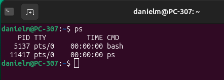[cite: 1]
* **Interpretación**: Muestra columnas como PID, %CPU, %MEM, tiempo de CPU acumulado y el comando asociado. Un administrador lo utiliza para identificar procesos colgados, verificar si un servicio está activo o comprobar el propietario de una tarea.

### `top`
* **Nombre y finalidad**: Herramienta interactiva en tiempo real que muestra el resumen global del rendimiento del sistema (CPU, memoria) y la lista dinámica de procesos activos[cite: 1].
* **Sintaxis**: `top [opciones]`[cite: 1, 2]
  * `-d [segundos]`: Modifica el intervalo de tiempo (en segundos) para actualizar la información en pantalla.
  * `-u [usuario]`: Filtra y muestra únicamente los procesos pertenecientes a un usuario específico.
* **Captura de pantalla**:
  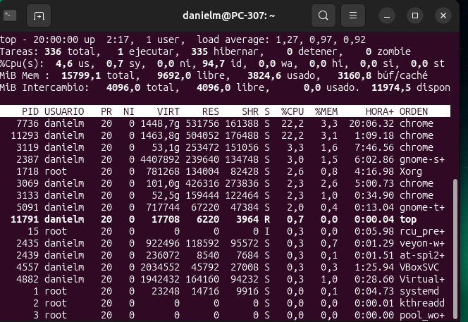[cite: 1]
* **Interpretación**: En la cabecera detalla la carga media del sistema (*load average*), uso global de CPU y memoria. En la lista inferior muestra los procesos ordenados por uso de CPU. Es útil para detectar picos repentinos de carga y responder a problemas en tiempo real[cite: 2].

### `htop`
* **Nombre y finalidad**: Versión avanzada, visual e interactiva de `top` que incluye soporte para ratón, barras de colores y gestión directa de procesos[cite: 1].
* **Sintaxis**: `htop [opciones]`[cite: 1, 2]
  * `-d [decimas]`: Establece el retardo de actualización en décimas de segundo.
  * `-u [usuario]`: Muestra exclusivamente los procesos pertenecientes al usuario indicado.
* **Captura de pantalla**:
  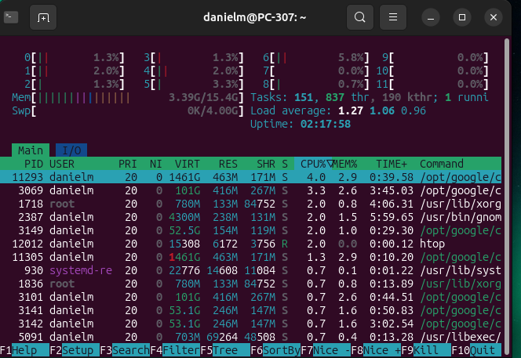[cite: 1]
* **Interpretación**: Ofrece una visualización intuitiva por barras para cada núcleo del procesador y la memoria RAM/Swap. Facilita la administración rápida (matar procesos con `F9` o cambiar la prioridad con `F7`/`F8`)[cite: 2].

### `atop`
* **Nombre y finalidad**: Monitor avanzado de recursos que registra y muestra el consumo acumulativo de CPU, memoria, disco y red tanto de procesos activos como inactivos. *(Instalación: `sudo apt install atop`)*[cite: 1, 2].
* **Sintaxis**: `atop [opciones]`[cite: 1, 2]
  * `-g`: Muestra información detallada del consumo agrupada por hilos de ejecución (*threads*).
  * `-m`: Prioriza y detalla el consumo de memoria por proceso.
* **Captura de pantalla**:
  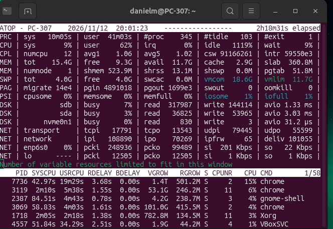[cite: 1]
* **Interpretación**: Ideal para auditorías profundas, ya que permite analizar no solo la situación instantánea sino también el histórico de rendimiento e identificar qué proceso generó un colapso en el pasado[cite: 2].

---

## 2. Memoria RAM

### `free`
* **Nombre y finalidad**: Muestra la cantidad total de memoria RAM física y de intercambio (*swap*) disponible, libre y utilizada en el sistema, además del espacio reservado para búferes y caché[cite: 1].
* **Sintaxis**: `free [opciones]`[cite: 1, 2]
  * `-h`: Muestra los valores de memoria en formato legible para humanos (MB, GB).
  * `-s [segundos]`: Actualiza la salida automáticamente en pantalla cada N segundos de manera continua.
* **Captura de pantalla**:
  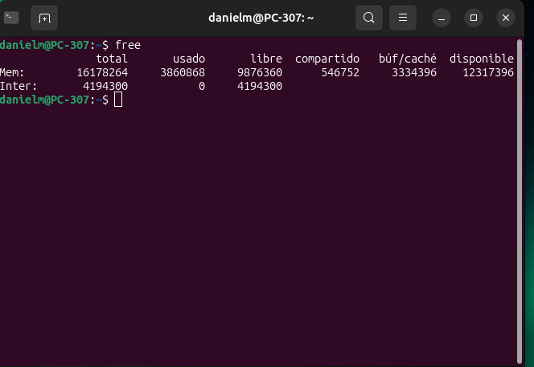[cite: 1]
* **Interpretación**: Permite a un administrador comprobar de forma inmediata si la memoria física está saturada o si el sistema está haciendo uso de memoria *swap*, lo que provocaría una degradación en el rendimiento general[cite: 2].

---

## 3. Almacenamiento

### `df`
* **Nombre y finalidad**: *Disk Free*. Informa sobre el espacio de almacenamiento total, libre y ocupado en los sistemas de ficheros montados en la máquina[cite: 1].
* **Sintaxis**: `df [opciones]`[cite: 1, 2]
  * `-h`: Muestra las capacidades y espacio ocupado en unidades legibles (ej. 20G, 450M).
  * `-T`: Añade una columna indicando el tipo de sistema de archivos (ext4, tmpfs, xfs) de cada partición.
* **Captura de pantalla**:
  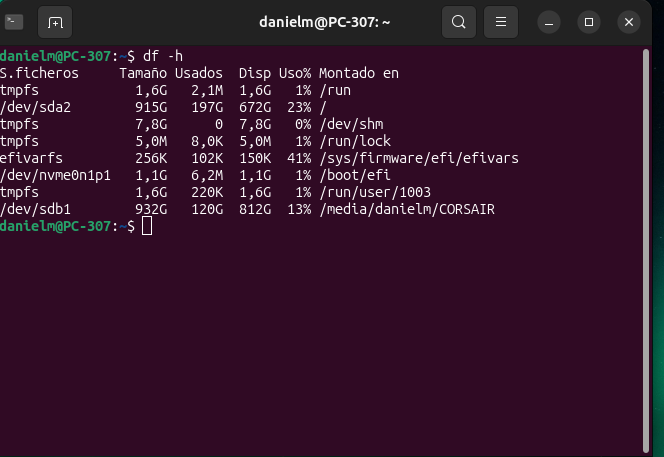[cite: 1]
* **Interpretación**: Esencial para vigilar que los puntos de montaje clave (como `/` o `/var`) no se queden sin espacio disponible, evitando bloqueos en servicios como bases de datos o registros del sistema[cite: 2].

### `du`
* **Nombre y finalidad**: *Disk Usage*. Estima y detalla el tamaño en disco consumido de forma específica por directorios y archivos[cite: 1].
* **Sintaxis**: `du [opciones] [ruta]`[cite: 1, 2]
  * `-h`: Muestra el tamaño ocupado en unidades comprensibles (K, M, G).
  * `-s`: Muestra un único resumen del tamaño total del directorio especificado sin listar sus subcarpetas.
* **Captura de pantalla**:
  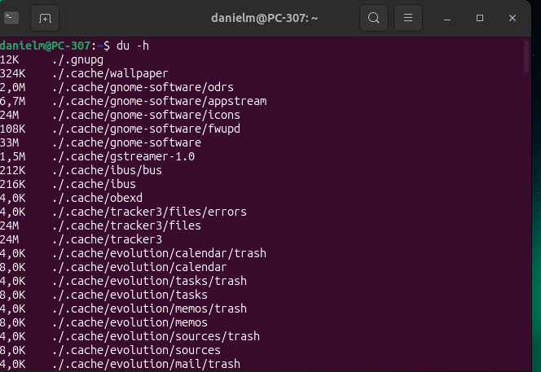[cite: 1]
* **Interpretación**: Permite auditar carpetas específicas para localizar qué archivos o subdirectorios pesados están consumiendo el espacio en un punto de montaje en particular[cite: 2].

### `iostat`
* **Nombre y finalidad**: Ofrece estadísticas sobre la carga de los dispositivos de entrada/salida (E/S) de almacenamiento y el uso de la CPU. *(Instalación: `sudo apt install sysstat`)*[cite: 1, 2].
* **Sintaxis**: `iostat [opciones]`[cite: 1, 2]
  * `-d`: Limita la salida a mostrar solo el rendimiento de las unidades de almacenamiento (omite la parte de la CPU).
  * `-x`: Proporciona datos extendidos (tiempos de espera, tasa de lectura/escritura y porcentaje de utilización del disco).
* **Captura de pantalla**:
  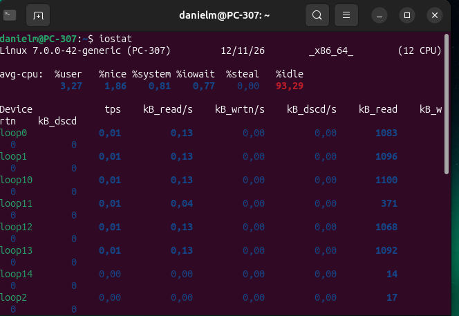[cite: 1]
* **Interpretación**: Ayuda a identificar si el disco duro o la unidad SSD representa un cuello de botella en el sistema debido a altas latencias de lectura/escritura o a la saturación de E/S (`%util`)[cite: 2].

---

## 4. Tráfico de Red

### `tcpdump`
* **Nombre y finalidad**: Analizador de paquetes en línea de comandos. Captura y muestra las tramas de red que circulan a través de una interfaz concreta[cite: 1]. *(Instalación: `sudo apt install tcpdump`)*[cite: 2].
* **Sintaxis**: `tcpdump [opciones]`[cite: 1, 2]
  * `-i [interfaz]`: Especifica la tarjeta de red sobre la que capturar (ej. `eth0`, `ens33`).
  * `-c [número]`: Detiene la captura tras interceptar el número especificado de paquetes.
* **Captura de pantalla**:
  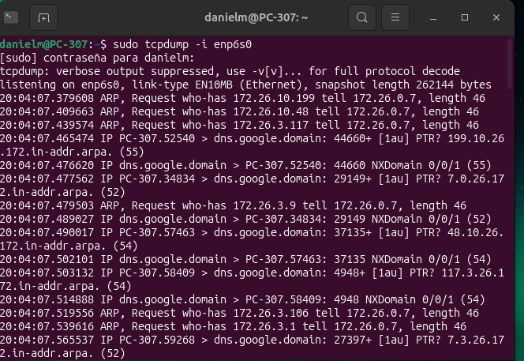[cite: 1]
* **Interpretación**: Muestra direcciones IP origen/destino, puertos y protocolos. Es la herramienta básica para diagnosticar problemas de conectividad, tráfico anómalo o peticiones no deseadas[cite: 2].

### `tcptrack`
* **Nombre y finalidad**: Monitoriza las conexiones TCP activas en una interfaz de red en tiempo real, detallando el consumo de ancho de banda por conexión[cite: 1]. *(Instalación: `sudo apt install tcptrack`)*[cite: 2].
* **Sintaxis**: `tcptrack -i [interfaz]`[cite: 1, 2]
  * `-d`: Muestra detalles del estado de las conexiones registradas.
* **Captura de pantalla**:
  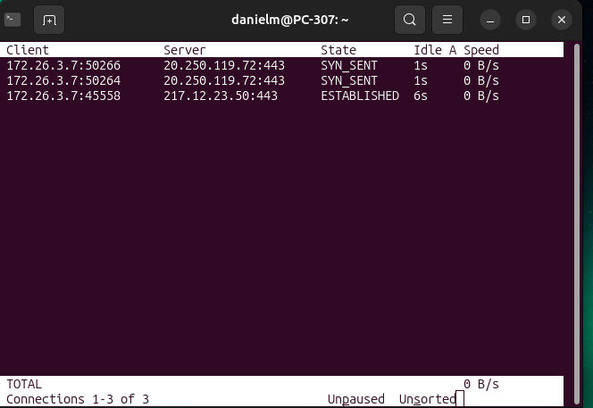[cite: 1]
* **Interpretación**: Permite saber en todo momento qué socket remoto o cliente está consumiendo la mayor parte del caudal de red del servidor[cite: 2].

### `iptraf-ng`
* **Nombre y finalidad**: Utilidad interactiva basada en ncurses para obtener estadísticas avanzadas de red: monitor de tráfico IP, estadísticas por interfaz y desglose por protocolos[cite: 1]. *(Instalación: `sudo apt install iptraf-ng`)*[cite: 2].
* **Sintaxis**: `iptraf-ng`[cite: 1, 2]
* **Captura de pantalla**:
  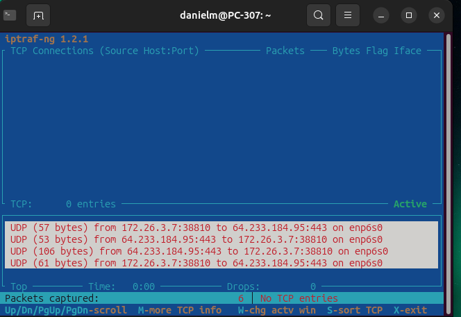[cite: 1]
* **Interpretación**: Ofrece una visión gráfica en consola ideal para analizar rápidamente los flujos globales de datos, paquetes TCP/UDP e imprevistos de saturación de red[cite: 2].

### `bmon`
* **Nombre y finalidad**: Monitor e inspector de ancho de banda que visualiza la tasa de transferencia en tiempo real con gráficos basados en caracteres de texto[cite: 1]. *(Instalación: `sudo apt install bmon`)*[cite: 2].
* **Sintaxis**: `bmon`[cite: 1, 2]
* **Captura de pantalla**:
  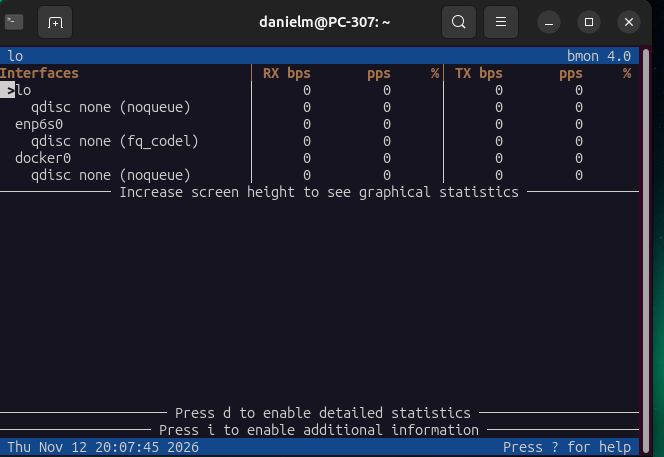[cite: 1]
* **Interpretación**: Permite observar de manera intuitiva las gráficas de recepción (RX) y transmisión (TX) para medir el volumen de tráfico entrante y saliente por interfaz[cite: 2].

---

## 5. Puertos y Conexiones

### `ss`
* **Nombre y finalidad**: Herramienta de inspección de sockets de red (sucesor de `netstat`). Muestra estadísticas de las conexiones de red activas en el kernel[cite: 1].
* **Sintaxis**: `ss [opciones]`[cite: 1, 2]
  * `-t`: Muestra únicamente los sockets TCP.
  * `-l`: Muestra exclusivamente los puertos en estado de escucha (*listening*).
* **Captura de pantalla**:
  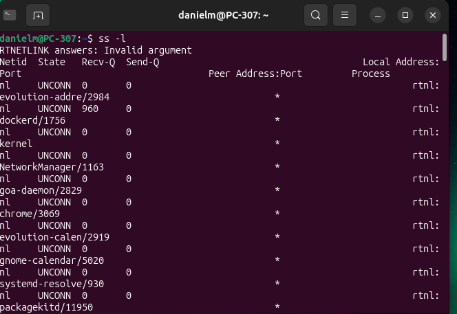[cite: 1]
* **Interpretación**: Fundamental para comprobar qué servicios del sistema están escuchando peticiones en qué puertos (ej. 80, 443, 22) y verificar la conectividad de los clientes[cite: 2].

### `nmap`
* **Nombre y finalidad**: Herramienta de auditoría de seguridad y escaneo de redes. Utilizada para descubrir hosts activos y la presencia de puertos abiertos o servicios en ejecución[cite: 1]. *(Instalación: `sudo apt install nmap`)*[cite: 2].
* **Sintaxis**: `nmap [opciones] [objetivo]`[cite: 1, 2]
  * `-p [puertos]`: Define el rango o número de puerto específico a escanear (ej. `-p 80,443` o `-p 1-1000`).
  * `-sV`: Sonda los puertos abiertos para obtener la versión del servicio o software que responde en ellos.
* **Captura de pantalla**:
  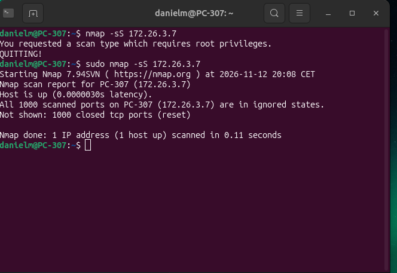[cite: 1]
* **Interpretación**: Informa sobre el estado del puerto (*open*, *closed*, *filtered*). Se utiliza en auditorías de red para asegurar que solo los servicios autorizados están expuestos al exterior[cite: 2].

---

## 6. Análisis de Resultados (Cuestionario)[cite: 2]

1. **¿Cómo comprobarías la cantidad de memoria RAM disponible?**[cite: 2]  
   Se puede comprobar ejecutando el comando `free -h` para obtener una visión en tiempo real formateada en Megabytes o Gigabytes. De igual forma, mediante utilidades como `htop` o `top` se supervisa tanto la memoria RAM en uso como la disponible.

2. **¿Qué diferencia existe entre `df` y `du`?**[cite: 2]  
   `df` (*Disk Free*) reporta el estado global de espacio libre y usado a nivel de sistemas de archivos y particiones montadas. Por su parte, `du` (*Disk Usage*) calcula de manera recursiva el espacio ocupado por archivos o directorios específicos elegidos por el usuario.

3. **¿Qué diferencias existen entre `ss` y `nmap`?**[cite: 2]  
   `ss` consulta directamente la tabla de sockets internamente en el sistema operativo local (para ver qué escucha o a qué se conecta la máquina). `nmap` envía paquetes de red hacia una dirección objetivo (sea local o remota) para averiguar desde fuera qué puertos se encuentran filtrados o abiertos.

4. **¿Cómo comprobarías si un servidor tiene abierto el puerto 80?**[cite: 2]  
   Localmente se verifica revisando los servicios a la escucha con el comando:
   ```bash
   ss -tuln | grep :80
